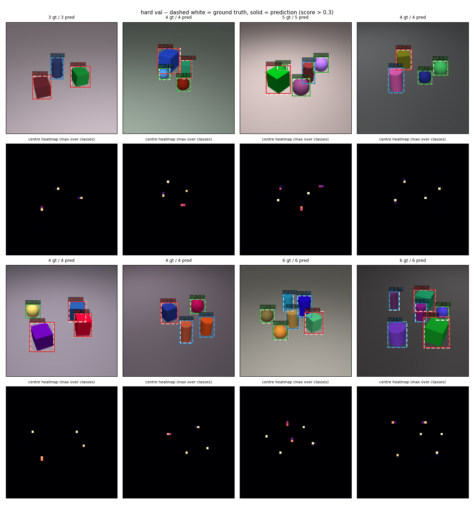

# mujoco-clutter-detect

Detects boxes, cylinders and spheres on a simulated tabletop: 0.91 mAP@[.5:.95] against 0.53 for a fitted classical pipeline. Static INT8 through ONNX Runtime runs the model in 1.38 ms on one thread; in C++ end to end the detector is under the classical pipeline in all six timing runs, by 0.5–7.8 %.



`hard/val`, 2000 images, 8992 objects, one training seed (0). Latency = model time, batch 1, one x86 box, idle; add 0.18 ms decode for end to end. Measured 2026-09-23 (steps 3, 5: 2026-09-06).

| graph | mAP@[.5:.95] | Δ mAP | ms, 1 thread | ms, 4 threads | MB |
|---|---|---|---|---|---|
| classical `bgsub+ws` (single-threaded) | 0.5322 | — | **2.13** | — | — |
| fp32, ONNX Runtime | **0.9107** | — | 3.57 | 1.52 | 1.53 |
| INT8 static, MinMax (= Entropy, same SHA-256) | 0.9097 | −0.0010 | **1.38** | **0.61** | 0.42 |
| INT8 dynamic (weights only) | 0.9097 | −0.0010 | 1.82 | 1.54 | 0.41 |
| pruned 25 % channels, fine-tuned 3 ep | 0.8919 | −0.0189 | 2.84 | — | 1.02 |
| pruned 50 % channels, fine-tuned 3 ep | 0.8454 | −0.0653 | 2.42 | — | 0.58 |
| pruned 50 % + INT8 | 0.8411 | −0.0697 | 1.25 | — | 0.18 |

Sim to real does not hold yet: on 50 real photos (HOPE) the `hard`-trained detector scores mAP 0.0063. The diagnosis is in [docs/RESULTS.md](docs/RESULTS.md#step-7--real-photos-hope-measured-2026-11-21).

## Quick start

Linux, Python 3.10+, CPU only.

```bash
git clone <this repo URL>
cd mujoco-clutter-detect
python3 -m venv .venv && . .venv/bin/activate        # first time only
pip install --index-url https://download.pytorch.org/whl/cpu \
    --extra-index-url https://pypi.org/simple -r requirements.txt   # first time only
./verify.sh
# AP metric (15 hand-computed cases), target encoding, INT8 round trip: all "ok", under a minute.
# Without the 2.9 GB dataset it stops at tier 3 and prints how to render the data.
python test_readme.py   # every number in this README and docs/RESULTS.md against runs/*.json
```

Rendering the dataset, training and the timing runs: [docs/RESULTS.md, Reproducing](docs/RESULTS.md#reproducing).

## How it works

- `gen_dataset.py` renders 3-6 objects per scene in MuJoCo and reads exact boxes from the segmentation buffer.
- `detector.py`: 381k-parameter anchor-free CNN, one centre heatmap per class plus offset and size.
- `export_onnx.py`, `quantize.py`: ONNX export and static INT8; `cpp/detect_ort.cpp` runs it through the ONNX Runtime C++ API.
- `ap.py`: hand-written COCO AP@[.5:.95]; `baseline_cv.py`: the classical background-subtraction + watershed baseline.

Full steps, findings and limits: [docs/RESULTS.md](docs/RESULTS.md). Walkthrough page: https://aungkaung1928.github.io/projects/clutter-detect.html

## License

MIT, see LICENSE.
